<!-- Theme: "Moonlit Sage" (dark) / "Morning Sage" (light). Artwork in ./assets is generated by tools/build.py; edit the text there and re-run. -->

<picture>
  <source media="(prefers-color-scheme: dark)" srcset="./assets/header-dark.svg" />
  <source media="(prefers-color-scheme: light)" srcset="./assets/header-light.svg" />
  
</picture>

<picture>
  <source media="(prefers-color-scheme: dark)" srcset="https://readme-typing-svg.demolab.com?font=Manrope&weight=600&size=21&pause=1200&color=8CC7A9&center=true&vCenter=true&width=720&lines=AI%2FML+Engineer+%40+Recklabs;Building+agentic+AI+and+LLM+systems;LangGraph+%C2%B7+LangChain+%C2%B7+FastAPI;Always+learning%2C+always+shipping" />
  <source media="(prefers-color-scheme: light)" srcset="https://readme-typing-svg.demolab.com?font=Manrope&weight=600&size=21&pause=1200&color=3F8F6E&center=true&vCenter=true&width=720&lines=AI%2FML+Engineer+%40+Recklabs;Building+agentic+AI+and+LLM+systems;LangGraph+%C2%B7+LangChain+%C2%B7+FastAPI;Always+learning%2C+always+shipping" />
  
</picture>

 

<!-- Once your portfolio is live, uncomment this and add the URL:

-->

<picture>
  <source media="(prefers-color-scheme: dark)" srcset="./assets/divider-dark.svg" />
  <source media="(prefers-color-scheme: light)" srcset="./assets/divider-light.svg" />
  
</picture>

## About me

I'm **Aditya Soran**, an **AI/ML Engineer at [Recklabs](https://recklabs.com)**, where I build **aisockt** — an enterprise AI platform that connects live business data from advertising, marketing, finance, sales and SEO tools to LLMs that answer questions and produce reports.

I specialise in **agentic AI workflows, RAG systems and full-stack LLM engineering**, working with **LangGraph, LangChain, FastAPI, PostgreSQL, Redis and BullMQ**, plus the MERN stack for end-to-end delivery. Before Recklabs, I was an AI Engineer at **Diglip7 Tech Pvt. Ltd.**, where I built **KAKA**, a multi-tenant WhatsApp AI appointment-booking agent for the clinic management platform **ZEVA**.

I graduated with a B.Tech in Information Technology from ABES Institute of Technology, Ghaziabad, hold a **Scopus-indexed research paper** (I3CSET-2025, Taylor & Francis), and completed an **80-hour AI/ML programme** with GI Ventures, an NVIDIA-certified partner.

> [!TIP]
> **Open to collaborating** on LLM applications, agentic AI systems, RAG pipelines and AI-native full-stack products.

## Experience

<picture>
  <source media="(prefers-color-scheme: dark)" srcset="./assets/experience-dark.svg" />
  <source media="(prefers-color-scheme: light)" srcset="./assets/experience-light.svg" />
  
</picture>

<b>Recklabs</b> &nbsp;·&nbsp; AI/ML Engineer &nbsp;·&nbsp; <i>click to see what I work on</i>

 

- **Connector integrations** — integrated and tested third-party data connectors end to end, including Meta Ads, TikTok Ads, Snapchat Ads, X Ads, DV360, Canva, Brand24 and Branch.
- **Model-agnostic presentation layer** — the selected LLM chooses UI components based on the query and connector output, and code renders them in a fixed design system, so answers look the same whichever model runs. Built to scale to 1,000+ connectors without per-connector configuration.
- **Branded report engine** — enhanced reports with selectable template designs and logo upload, for client-ready output.
- **Centralised administration** — users, connector access, a credential vault, configuration and audit logs in one admin panel.
- **Production deployment** — aisockt.com on AWS EC2 with Cloudflare DNS and SSL, released from the production branch through read-only Git deploy keys.

<b>Diglip7 Tech</b> &nbsp;·&nbsp; AI Engineer &nbsp;·&nbsp; <i>click to see KAKA</i>

 

- Built **KAKA**, a multi-tenant WhatsApp AI agent that books appointments for **ZEVA**, a clinic management platform.
- Worked across multi-tenant architecture, WhatsApp API integrations, real-time analytics dashboards and production LLM orchestration.
- Stack: LangGraph, LangChain, FastAPI, PostgreSQL, Redis, BullMQ and the MERN stack.

## Featured projects

  <a href="https://github.com/adityasoran0698/CuraLink"><picture><source media="(prefers-color-scheme: dark)" srcset="./assets/project-curalink-dark.svg" /><source media="(prefers-color-scheme: light)" srcset="./assets/project-curalink-light.svg" /></picture></a>
  <a href="https://github.com/adityasoran0698/VibeAI"><picture><source media="(prefers-color-scheme: dark)" srcset="./assets/project-vibeai-dark.svg" /><source media="(prefers-color-scheme: light)" srcset="./assets/project-vibeai-light.svg" /></picture></a>

  <a href="https://ayur-sutra-coral.vercel.app/"><picture><source media="(prefers-color-scheme: dark)" srcset="./assets/project-ayursutra-dark.svg" /><source media="(prefers-color-scheme: light)" srcset="./assets/project-ayursutra-light.svg" /></picture></a>
  <a href="https://github.com/adityasoran0698?tab=repositories"><picture><source media="(prefers-color-scheme: dark)" srcset="./assets/project-youtube-dark.svg" /><source media="(prefers-color-scheme: light)" srcset="./assets/project-youtube-light.svg" /></picture></a>

  <b>Live demos</b> &nbsp;→&nbsp;
  <a href="https://deployed-curalink.vercel.app/">CuraLink</a> &nbsp;·&nbsp;
  <a href="https://chat-bot-langgraph.vercel.app/">VibeAI</a> &nbsp;·&nbsp;
  <a href="https://ayur-sutra-coral.vercel.app/">AyurSutra</a>

<b>More projects</b> &nbsp;·&nbsp; <i>click to expand</i>

 

| Project | What it does | Stack |
| --- | --- | --- |
| [**AI Research Analyser**](https://github.com/adityasoran0698/ai-research-analyser) | Enter a paper title, pick an explanation style (Beginner, Technical, Code-oriented, Mathematical) and get a structured LLM breakdown. | React, FastAPI, LangChain, OpenAI |
| [**YouTube Chatbot**](https://github.com/adityasoran0698?tab=repositories) | RAG over video transcripts with ChromaDB; supports Hindi and multilingual videos. | LangChain, ChromaDB, FastAPI, GPT-4o |
| [**All repositories →**](https://github.com/adityasoran0698?tab=repositories) | | |

## Achievements

<picture>
  <source media="(prefers-color-scheme: dark)" srcset="./assets/achievements-dark.svg" />
  <source media="(prefers-color-scheme: light)" srcset="./assets/achievements-light.svg" />
  
</picture>

<i>click for details</i>

 

- **Smart India Hackathon 2024** — built AyurSutra, an AI-powered Ayurveda therapy platform, under the Ministry of AYUSH.
- **Certificate of Distinction, CuraLink Hackathon v2.0** — for CuraLink, combining parallel API orchestration with FAISS-based semantic search.
- **Research paper, I3CSET-2025** — published by Taylor & Francis, Scopus-indexed.
- **AI/ML training** — 80-hour programme with GI Ventures, an NVIDIA-certified partner.

## Tech stack

**Generative AI & agents**

**Engineering**

<picture>
  <source media="(prefers-color-scheme: dark)" srcset="https://skillicons.dev/icons?i=py,fastapi,nodejs,express,redis,react,ts,nextjs,tailwind,redux,postgres,mongodb,mysql,aws,cloudflare,docker,git,github,postman,vercel&theme=dark&perline=10" />
  <source media="(prefers-color-scheme: light)" srcset="https://skillicons.dev/icons?i=py,fastapi,nodejs,express,redis,react,ts,nextjs,tailwind,redux,postgres,mongodb,mysql,aws,cloudflare,docker,git,github,postman,vercel&theme=light&perline=10" />
  
</picture>

## GitHub activity

  <picture>
    <source media="(prefers-color-scheme: dark)" srcset="https://githubstatscard.vercel.app/api/stats" />
    <source media="(prefers-color-scheme: light)" srcset="https://githubstatscard.vercel.app/api/stats?theme=light" />
    
  </picture>
  <picture>
    <source media="(prefers-color-scheme: dark)" srcset="https://streak-stats.demolab.com?user=adityasoran0698&hide_border=true&background=0B1416&stroke=1E3634&ring=8CC7A9&fire=9DB7E0&currStreakNum=E7EFEC&sideNums=E7EFEC&currStreakLabel=8CC7A9&sideLabels=93A8A5&dates=5E7471" />
    <source media="(prefers-color-scheme: light)" srcset="https://streak-stats.demolab.com?user=adityasoran0698&hide_border=true&background=F5F8F6&stroke=D6E4DE&ring=3F8F6E&fire=4F6FA8&currStreakNum=1C2B2A&sideNums=1C2B2A&currStreakLabel=3F8F6E&sideLabels=566B67&dates=8A9B97" />
    
  </picture>

<picture>
  <source media="(prefers-color-scheme: dark)" srcset="https://github-readme-activity-graph.vercel.app/graph?username=adityasoran0698&bg_color=0B1416&color=93A8A5&line=8CC7A9&point=9DB7E0&area=true&area_color=8CC7A9&title_color=E7EFEC&hide_border=true&custom_title=Contribution%20activity" />
  <source media="(prefers-color-scheme: light)" srcset="https://github-readme-activity-graph.vercel.app/graph?username=adityasoran0698&bg_color=F5F8F6&color=566B67&line=3F8F6E&point=4F6FA8&area=true&area_color=3F8F6E&title_color=1C2B2A&hide_border=true&custom_title=Contribution%20activity" />
  
</picture>

<b>Watch the snake eat my contributions</b> &nbsp;·&nbsp; <i>click to play</i>

 

  <picture>
    <source media="(prefers-color-scheme: dark)" srcset="https://raw.githubusercontent.com/adityasoran0698/adityasoran0698/output/github-snake-dark.svg" />
    <source media="(prefers-color-scheme: light)" srcset="https://raw.githubusercontent.com/adityasoran0698/adityasoran0698/output/github-snake.svg" />
    
  </picture>

 

<picture>
  <source media="(prefers-color-scheme: dark)" srcset="./assets/footer-dark.svg" />
  <source media="(prefers-color-scheme: light)" srcset="./assets/footer-light.svg" />
  
</picture>

  
  
  

